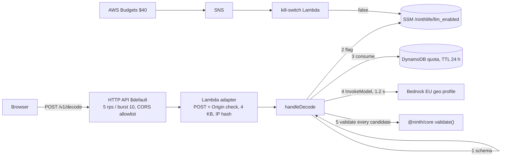

# Design: decoder-service

Requirements: `.kiro/specs/decoder-service/requirements.md` (DS-1 to DS-8).
Knowledge base: `docs/architecture/decoder.md`. Model research: `docs/research/bedrock-models.md`.

## Overview

`handleDecode(body, meta, deps)` is a pure, framework-agnostic function (`packages/decoder/src/handler.ts`).
Two adapters call it: AWS Lambda behind API Gateway HTTP API (production, `src/adapters/lambda.ts`)
and a Next.js Route Handler (dev, `packages/web/app/api/decode/route.ts`).

## Components

| Module | Responsibility | Requirements |
|---|---|---|
| `schema.ts` | zod request schema, limits, `readBody()` (4 KB, JSON), error shapes | DS-5 |
| `prompt.ts` | frozen system prompt with 7 invented few-shots; user turn from lattice, beams, context | DS-8 |
| `parse.ts` | find the JSON object, salvage complete arrays from truncated output | DS-1.4, DS-2.2 |
| `llm.ts` | `LlmClient`; `BedrockLlmClient` (InvokeModel, maxAttempts 1, EU guard); `FakeLlmClient` | DS-2.4, DS-7.4 |
| `models.ts` | profile IDs, foundation-model IDs, EU destination Regions, prices, IAM ARN builder | DS-7 |
| `quota.ts` | `QuotaStore`; DynamoDB (one conditional TransactWriteItems) and in-memory | DS-4 |
| `flags.ts` | `SsmFlags` (30 s cache, fail closed), `EnvFlags`, `StaticFlags` | DS-3 |
| `log.ts` | `DecodeMetrics` type: the whole logging vocabulary | DS-6 |
| `handler.ts` | orchestration, timeout, validation, dedupe, merge, fallback | DS-1, DS-2, DS-3, DS-4 |
| `adapters/lambda.ts` | API Gateway v2 event, Origin allowlist, salted per-day IP hash | DS-5.4, DS-6.3 |
| `infra/lib/ninth-life-stack.ts` | HTTP API, Lambda, table, SSM, IAM, SNS, Budget | DS-3.2, DS-4.7-8, DS-7.1-3 |
| `infra/lib/killswitch.ts` | inline kill-switch Lambda subscribed to SNS | DS-3.2 |

## Key decisions

1. **InvokeModel, not Converse.** InvokeModel takes the native Anthropic Messages body, so
   `cache_control`, `thinking` and each model's sampling rules are sent as Anthropic documents them.
   The pinned `@aws-sdk/client-bedrock-runtime` 3.712.0 has no Converse `cachePoint` type. Nova Micro
   gets its own `messages-v1` body behind the same interface.
2. **No structured outputs (constrained decoding).** Bedrock compiles a grammar for a new schema in
   up to about 90 s and caches it for 24 h; a cold compile would blow the 1.2 s deadline. The
   validator, not the JSON format, is the safety mechanism, so a prompt-specified format plus a
   tolerant parser is enough.
3. **Server deadline 1,200 ms, client 1,500 ms.** The server answers (degraded, with ghost beams)
   before the client gives up.
4. **One transaction for three counters.** Per-IP-minute, per-IP-day and global-day increments are
   conditional updates in one TransactWriteItems, so a refused request counts nowhere and the
   cancelled index tells which limit hit.
5. **Fail closed.** Flag read errors disable the LLM; quota store errors return 503.
6. **Per-day salted IP hash.** `sha256(salt | UTC day | ip)`. Hashes do not link across days.
7. **Budget without a service filter.** Claude on Bedrock is billed through AWS Marketplace under
   the provider, not under "Amazon Bedrock"; a service filter would miss it. Use a dedicated account.
8. **Per-model request rules.** Haiku 4.5: temperature 0.3, no cache checkpoint (minimum 4,096
   tokens; the prompt is about 1K). Haiku 5.5: no temperature (non-default values return 400),
   `thinking: {type: "disabled"}`, cache checkpoint on the system prompt (minimum 512).

## Data model

DynamoDB table, partition key `pk` (S), TTL attribute `ttl` (epoch seconds, now + 24 h):

| pk | attributes | condition on increment |
|---|---|---|
| `ip#<hash>#m#<minute>` | `n` | `n < 30` |
| `ip#<hash>#d#<YYYY-MM-DD>` | `n` | `n < 300` |
| `g#d#<YYYY-MM-DD>` | `n`, `usd` (micro-dollars) | `n < 20000 AND usd < 8000000` |

## Correctness properties

| ID | Property | Validates | Test |
|---|---|---|---|
| P1 | For any model output text (valid JSON, truncated JSON, junk, unicode look-alikes) and any client beams, every returned candidate passes core `validate()` and an independent keypad oracle; at most `k`; no duplicates. Non-vacuity guards require accepted and rejected cases in the run. | DS-1.1, 1.3, 1.4, 1.5 | `test/handler.test.ts` "DS-1 soundness" (300 runs) |
| P2 | Same as P1 in initials mode. | DS-1.1 | `test/handler.test.ts` "soundness in initials mode" |
| P3 | For any partner text and words, on every path (ok, timeout, error with the text in its message, junk reply, kill switch, 400), nothing printed to the console contains the request text, words or the IP hash, and every string field is in the fixed vocabulary. | DS-6.1, 6.2 | `test/handler.test.ts` "DS-6 privacy" |
| P4 | Mutation check: disabling the validator line in `handler.ts` makes P1 and P2 fail. | DS-1.1 | manual, recorded in `docs/architecture/decoder.md` ("Testing") |
| E1 | Timeout, error, unparseable and all-rejected replies return 200 with validated ghost beams and `degraded: true`; the default deadline is under 1,500 ms. | DS-2.1-2.3 | `test/handler.test.ts` fallback block |
| E2 | Kill switch off: 503, no quota consumed, no model call. SSM error: disabled. Flip seen within the 30 s cache. | DS-3.1, 3.3, 3.4 | `test/handler.test.ts`, `test/flags.test.ts` |
| E3 | 30/min, 300/day, global count and dollar caps; refused requests not counted; store failure is 503. | DS-4.1-4.6 | `test/quota.test.ts`, `test/handler.test.ts` |
| E4 | Schema limits at their boundaries; 4,096 bytes ok, 4,097 is 413; errors do not echo values. | DS-5.1-5.3 | `test/schema.test.ts` |
| E5 | Every few-shot answer and lattice word validates; the system prompt is constant and dateless. | DS-8.1, 8.4 | `test/prompt.test.ts` |
| E6 | Bedrock bodies per model (temperature, thinking, cache_control); EU guard refuses non-EU Regions. | DS-7.4, DS-8.5 | `test/llm.test.ts` |
| E7 | Synthesized template: Node 22 arm64, reserved concurrency 5, stage 5/10, CORS allowlist, TTL, flag, $40 budget to SNS, kill-switch subscription, Bedrock IAM only on EU ARNs with `bedrock:InferenceProfileArn`, no non-EU Region anywhere, stack refuses other Regions. | DS-3.2, 4.7, 4.8, 5.4, 7.1-7.3 | `packages/infra/test/stack.test.ts` |
| E8 | Kill-switch source: an SNS record sets the flag to "false"; the message is not logged. | DS-3.2 | `packages/infra/test/stack.test.ts` |

## Error handling

| Condition | Status | Body |
|---|---|---|
| Body over 4 KB | 413 | `{"error":"too_large","maxBytes":4096}` |
| Schema or JSON error | 400 | `{"error":"bad_request","issues":[...paths]}` |
| Wrong method / origin (Lambda) | 405 / 403 | `method_not_allowed` / `forbidden_origin` |
| Kill switch off | 503 | `{"error":"llm_disabled","reason":"kill_switch"}` |
| Global daily cap | 503 | `{"error":"llm_disabled","reason":"daily_cap"}` |
| Per-IP limit | 429 | `{"error":"rate_limited","retryAfter":N}` + `Retry-After` |
| Quota store or salt unavailable | 503 | `{"error":"unavailable"}` |
| Model timeout, error, refusal, junk | 200 | ghost beams, `degraded: true`, `model: "ghost"` |
