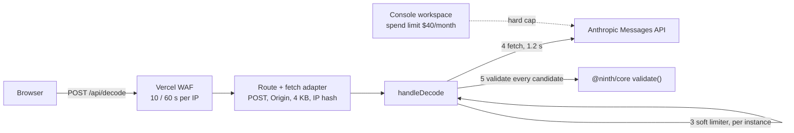

# Design: decoder-service

Requirements: `.kiro/specs/decoder-service/requirements.md` (DS-1 to DS-9).
Knowledge base: `docs/architecture/decoder.md`. Decisions: `docs/decisions/ADR-001-anthropic-api-no-aws.md`,
`ADR-002-minimax-provider.md` (a second provider through the same client: provider profiles in `src/models.ts`,
`messagesUrl` / `requestHeaders` per provider, `defaultModelFor(env)`, `timeoutFromEnv`).
Model research: `docs/research/anthropic-models.md`, `docs/research/minimax-models.md` (MiniMax-M3 chosen over
M3.1-Flash for the route; prompt v6 puts the conversation first). Reply type: `ADR-008-reply-types-steer-ranking.md`
(prompt v8, `PROMPT_VERSION` in `src/prompt.ts`).

## Overview

`handleDecode(body, meta, deps)` is a pure, framework-agnostic function (`packages/decoder/src/handler.ts`).
`createFetchHandler()` (`src/adapters/fetch.ts`) wraps it as a Web-standard `Request -> Response`
handler, and the Next.js Route Handler `packages/web/app/api/decode/route.ts` on Vercel exposes it.

## Components

| Module | Responsibility | Requirements |
|---|---|---|
| `schema.ts` | zod request schema (optional `context.intent`: `REPLY_INTENT_VALUES`), limits, `readBody()` (4 KB, JSON), error shapes | DS-5, DS-9.1 |
| `prompt.ts` | `PROMPT_VERSION` (v8); frozen system prompt with 8 rules and 8 invented few-shots; user turn from lattice, beams, context, `<reply_type>` | DS-8, DS-9.2, 9.5 |
| `parse.ts` | find the JSON object, salvage complete arrays from truncated output | DS-1.4, DS-2.2 |
| `llm.ts` | `LlmClient`; `AnthropicLlmClient` (fetch, no retries, body per model, cache rule); `FakeLlmClient` | DS-2.4, DS-7 |
| `models.ts` | model IDs, prices, cache minimums, thinking rule, cost estimate | DS-4.7, DS-7 |
| `quota.ts` | `QuotaStore`; `MemoryQuotaStore` (best effort, per instance) | DS-4.2 - 4.7 |
| `flags.ts` | `EnvFlags` (`LLM_ENABLED`), `StaticFlags` | DS-3.1 |
| `log.ts` | `DecodeMetrics`: the whole logging vocabulary | DS-6 |
| `handler.ts` | orchestration, timeout, validation, dedupe, merge, fallback; `context.intent` reaches only `buildPrompt` | DS-1, DS-2, DS-3.1, DS-4, DS-9.3 |
| `adapters/fetch.ts` | POST + Origin + size checks, salted per-day IP hash, `configFromEnv()` | DS-3.2, 3.4, DS-5.4, DS-6.3 |
| Vercel WAF rule, Console spend limit | dashboard configuration (runbook in `docs/architecture/decoder.md`) | DS-3.3, DS-4.1 |

## Key decisions

1. **Anthropic Messages API over plain `fetch`** (ADR-001). One non-streaming call; the skill's SDK
   default allows raw HTTP when asked, and fetch keeps the route dependency-free and easy to mock.
2. **API version 2026-10-21, no sampling parameters.** `temperature` is a 400 on every model on this
   version; both Haikus sample at the default.
3. **Haiku 5.5: thinking disabled, system prompt cached.** It thinks by default and the thinking
   would use the 120-token budget; its 512-token cache minimum is met (~840 tokens). Haiku 4.5: no
   cache checkpoint (4,096 minimum).
4. **No structured outputs.** The validator, not the JSON format, is the safety mechanism; a tolerant
   parser is enough.
5. **Server deadline 1,200 ms, client 1,500 ms, no retries.**
6. **No shared store.** Per-IP limiting is the Vercel WAF rule; the hard cap is the Console spend
   limit; the in-memory limiter is a soft, per-instance guard (ADR-001 trade-offs).
7. **Fail closed.** No key or `LLM_ENABLED` not `"true"`: 503. Limiter errors: 503.
8. **Per-day salted IP hash** (`sha256(IP_HASH_SALT | day | ip)`), memory only.
9. **Reply type steers ranking only** (ADR-008). `context.intent` is one of three fixed words, so it
   is rendered as `<reply_type>agree</reply_type>` without sanitizing; `renderUserTurn` drops any
   other value even if a caller skips the schema. Rule 8 says it only orders readings and never
   changes rules 1 to 4. The ghost fallback needs nothing server-side: the client sends beams it
   already re-ranked with `rankByIntent` (`@ninth/core`). Prompt v8 adds one few-shot (`66 69 929`,
   guesses `no my way` / `on my way`, partner "Are you coming?", agree -> `on my way`); the system
   prompt grows from about 933 to 1,071 estimated tokens (chars / 4), still above the Haiku 5.5 cache
   minimum and under the 1,500 test bound. No quality claim until an eval is in `packages/eval/RESULTS.md`.

## Correctness properties

| ID | Property | Validates | Test |
|---|---|---|---|
| P1 | For any model output text (valid JSON, truncated JSON, junk, unicode look-alikes), any client beams and any reply type (or none), every returned candidate passes core `validate()` and an independent keypad oracle; at most `k`; no duplicates. Non-vacuity guards require accepted and rejected cases. | DS-1.1, 1.3, 1.4, 1.5, DS-9.3 | `test/handler.test.ts` "DS-1 soundness" (300 runs) |
| P2 | Same as P1 in initials mode. | DS-1.1 | `test/handler.test.ts` |
| P3 | For any partner text, words and reply type, on every path (ok, rejected word in the response, timeout, error with the text in its message, junk reply, kill switch, 400, 400 for an unknown reply type), nothing printed contains the request text, words, the IP hash, an `intent` / `reply_type` key or a reply-type value, and every string field is in the fixed vocabulary. | DS-6.1, 6.2, DS-9.4 | `test/handler.test.ts` "DS-6 privacy" |
| P4 | Mutation check: disabling the validator line in `handler.ts` makes P1 and P2 fail. | DS-1.1 | manual, recorded in `docs/architecture/decoder.md` history |
| P5 | For any model output, client beams, k and mode: every `rejectedWords` entry is in no returned candidate, does not match its slot (core and the oracle agree), has `expectedCode = codes[slot]`, is a-z/apostrophe and at most 16 characters, is unique per (slot, word), comes from the normalized reply; at most 5; the reply passes `DecodeResponseSchema`. Non-vacuity guard. Mutation check: dropping the "not in candidates" or the shape filter fails P5. | DS-1.7 | `test/handler.test.ts` "DS-1.7 rejected words ..." (300 runs) |
| E1 | Timeout, error, unparseable and all-rejected replies return 200 with validated ghost beams and `degraded: true`; a slow `fetch` is aborted by the deadline. | DS-2 | `test/handler.test.ts`, `test/llm.test.ts` |
| E2 | `LLM_ENABLED` unset or not exactly `"true"`: 503, no limiter use, no model call; no key: forced off. | DS-3.1, 3.2 | `test/handler.test.ts`, `test/flags.test.ts`, `test/fetch-adapter.test.ts` |
| E3 | Soft limiter: 30/min, 300/day, daily count and dollar caps; refused requests not counted; store failure is 503. | DS-4.2 - 4.6 | `test/quota.test.ts`, `test/handler.test.ts` |
| E4 | Schema limits at their boundaries; 4,096 bytes ok, 4,097 is 413; errors do not echo values; `context.intent` accepts agree / disagree / ask only, and the 400 names the path, never the value. | DS-5.1 - 5.3, DS-9.1 | `test/schema.test.ts`, `test/fetch-adapter.test.ts` |
| E5 | Every few-shot answer and lattice word validates (the reply-type few-shot too); the system prompt is constant and dateless, whatever the reply type. | DS-8.1, 8.4, DS-9.5 | `test/prompt.test.ts` |
| E6 | Mocked fetch: URL, `x-api-key`, `anthropic-version: 2026-10-21`, body per model (no sampling params, thinking rule, cache rule), status mapping without body text, refusal handling. | DS-7 | `test/llm.test.ts` |
| E8 | Prompt v8: rule 8 text; `<reply_type>` only when given, after `<partner>` and before `<recent>`; any other value never rendered (property); the handler passes `context.intent` to the prompt; an unknown value is a 400 before the model; degraded replies keep the client's (re-ranked) beam order; a reply type never lets an invalid word through. | DS-9.1 - 9.3 | `test/prompt.test.ts` "reply type", `test/handler.test.ts` "reply type (DS-9)" |
| E7 | Route adapter: 405, 403 (foreign or missing Origin in production), 413 before the model, IP hashed, env wiring (default model, `DECODE_MODEL`, fake ignored in production, key never in warnings). | DS-3.4, DS-5.4, DS-6.3 | `test/fetch-adapter.test.ts` |

## Error handling

| Condition | Status | Body |
|---|---|---|
| Body over 4 KB | 413 | `{"error":"too_large","maxBytes":4096}` |
| Schema or JSON error | 400 | `{"error":"bad_request","issues":[...paths]}` |
| Wrong method / origin | 405 / 403 | `method_not_allowed` / `forbidden_origin` |
| WAF rule (per IP) | 429 | Vercel's response |
| Kill switch off or no key | 503 | `{"error":"llm_disabled","reason":"kill_switch"}` |
| Soft daily cap (per instance) | 503 | `{"error":"llm_disabled","reason":"daily_cap"}` |
| Soft per-IP limit (per instance) | 429 | `{"error":"rate_limited","retryAfter":N}` + `Retry-After` |
| Limiter failure | 503 | `{"error":"unavailable"}` |
| Model timeout, HTTP error, spend limit reached, refusal, junk | 200 | ghost beams, `degraded: true`, `model: "ghost"` |
